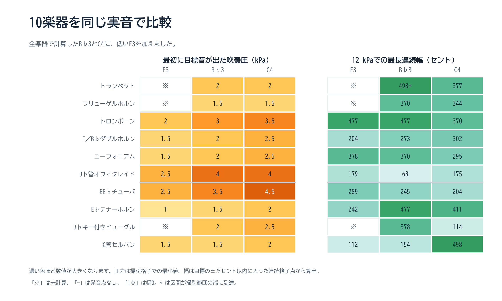
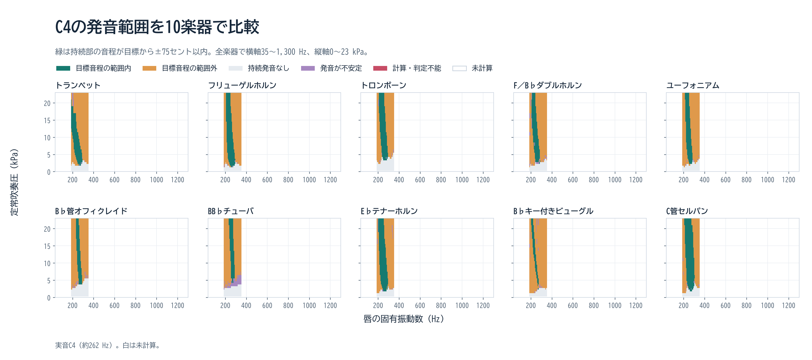

# 10楽器の発音範囲の比較

トランペット、フリューゲルホルン、トロンボーン、F／B♭ダブルホルン、ユーフォニアム、B♭管オフィクレイド、BB♭チューバ、E♭テナーホルン、B♭キー付きビューグル、C管セルパンの発音範囲を比較します。実音B♭3とC4は全10楽器で比較できます。各音の図はすべて横軸が唇の固有振動数35〜1,300 Hz、縦軸が定常吹奏圧0〜23 kPaです。緑は目標音程の±75セント以内で持続した点、白は未計算、赤は計算や判定ができなかった点です。





## 計算条件と形状

| 今回追加した楽器 | 実音域 | 音数 | 運指と管長補正 |
|---|---|---:|---|
| BB♭チューバ | B♭1〜B♭4 | 22 | 既存の4バルブ運指、全音−50 mm |
| E♭テナーホルン（アルトホルン） | B♭2〜B♭5 | 22 | 既存の3バルブ運指、全音−50 mm |
| B♭キー付きビューグル | B♭3〜B♭5 | 15 | 既存の7鍵の開閉、クローク−90 mm |
| C管セルパン | C2〜C4 | 17 | Cメジャー15音とB♭2・B♭3、標準の6孔運指、補正0 mm |

各音に定常吹奏圧0.5〜22 kPaの24点、唇の固有振動数は目標音の0.72〜1.34倍の32点を使いました。静止時の唇の開き27 μm、立ち上げ14 ms、一時増圧22%、減衰27 msは全試行で共通です。各条件で0.48秒を計算し、0.24〜0.36秒と0.36〜0.48秒のカップ圧の周期性、周波数差、音圧で持続を判定します。この設定では音程差±75セントを許容します。唇の機械定数とマウスピースは楽器ごとの既存モデルを固定して使いました。今回の音高探索範囲は18 Hz以上で、以前の高音楽器の掃引は低い探索端が異なります。

チューバはAlexander系の再構成管体とYamaha BB-67C4相当、テナーホルンはAdolphe Sax製のEU4543の管径とYamaha AH-38D4相当、ビューグルはHalariのEU907と既存の推定開孔寸法、セルパンは教科書図4.56と図7.55(a)からの管体とマウスピースを使用しました。E♭テナーホルンの上端4音は通常の実用域を超えるモデル上の拡張です。[教科書第4章](https://doi.org/10.1007/978-3-030-55686-0_4) · [教科書第7章](https://doi.org/10.1007/978-3-030-55686-0_7) · [C管セルパンの運指表](https://www.jeremywest.co.uk/uploads/1/4/6/0/14606206/fingering_chart_serpent_in_c.pdf)

唇と唇間の流れは非線形に解き、主掃引の管内の戻り波には線形の応答を使いました。BB♭チューバ、E♭テナーホルン、B♭キー付きビューグルの線形応答には主に軸対称モデルの微小パルスを使いました。高周波域の伝達行列には、必要に応じて開孔の並列負荷も含めます。チューバのC2のみ、微小応答で直流近傍に小さな過大反射があったため受動的な伝達行列を全帯域で使用しました。セルパンではパルス応答を有限長の戻り波に変換した段階で、約2〜6 Hzに非物理的な増幅が発生しました。低周波域を補正しても開孔時の共鳴に差があったため、セルパンの最終図には全帯域で開孔負荷を含む受動的な伝達行列を使いました。代表点を同じ幾何・運指の軸対称圧縮性Eulerモデルで照合しています。

## 全10楽器の同じ実音での比較

圧力は測った格子上で最初に成功した定常値、幅は12 kPaで連続した成功点の最長区間をセントに直した値です。

| 楽器 | B♭3の最初の成功圧 kPa | B♭3の幅 セント | C4の最初の成功圧 kPa | C4の幅 セント |
|---|---:|---:|---:|---:|
| トランペット | 2 | 498 | 2 | 377 |
| フリューゲルホルン | 1.5 | 370 | 1.5 | 344 |
| トロンボーン | 3 | 477 | 3.5 | 370 |
| F／B♭ダブルホルン | 2 | 273 | 2.5 | 302 |
| ユーフォニアム | 2 | 370 | 2.5 | 295 |
| B♭管オフィクレイド | 4 | 68 | 4 | 175 |
| BB♭チューバ | 3.5 | 245 | 4.5 | 204 |
| E♭テナーホルン | 1.5 | 477 | 2 | 411 |
| B♭キー付きビューグル | 2 | 378 | 2.5 | 114 |
| C管セルパン | 1.5 | 154 | 2 | 498 |

トランペットのB♭3は連続成功帯が掃引の下端に届いています。表示した幅は掃引内の値です。

### 新たに計算した4楽器

- **BB♭チューバ。** B♭1は1 kPaで発音しました。この音はBB♭管の通常の低音で、B♭管ユーフォニアムの同じ実音のペダル音とは共鳴次数が違います。C4は同じ実音を吹く10楽器の中でも高い4.5 kPaからでした。上端B♭4は、管長を保ったまま唇の機械定数を既存の高音プリセットに替えると、最初の成功圧が15 kPaから5 kPaに動きました。
- **E♭テナーホルン。** B♭3は1.5 kPa、C4は2 kPaで発音しました。C4の12 kPaでの幅は411セントです。上端B♭5では、既存の高音に合わせた唇の機械定数で8 kPaから発音を確認しました。
- **B♭キー付きビューグル。** C4は2.5 kPaで立ち上がりましたが、12 kPaの幅は114セントで、トランペットの377セントより狭くなりました。選んだC4の運指では第1・3・4孔を開き、回り込む反射と放射も近似します。
- **C管セルパン。** 全閉のC4は2 kPaから、第1〜3孔を開けたB♭3は1.5 kPaから発音しました。開孔や唇の調整で近い発音モードを選ぶ楽器です。歴史的な個体の実測でも、運指ごとの共鳴と実際の音程の対応が複雑であることが報告されています。[セルパンの入力インピーダンスの実測](https://www.sciencedirect.com/science/article/abs/pii/S1296207416300061)

高音用の唇設定を用いた非線形照合でも、次の条件で確認しました。

- BB♭チューバ B♭4、吹奏圧9 kPa、唇の固有振動数512.8 Hzで目標音（周期周波数468.7 Hz）。
- E♭テナーホルン B♭5、吹奏圧12 kPa、唇の固有振動数1006.9 Hzで目標音（周期周波数934.3 Hz）。

## 代表点の軸対称非線形計算

複数の吹奏圧と固有振動数で照合しました。以下の非線形の圧力も選んだ格子点の値です。定常分岐や奏者が調整できる最低圧は別の量です。

| 楽器 | 判定一致 | B♭3の最小確認圧 kPa | C4の最小確認圧 kPa |
|---|---:|---:|---:|
| BB♭チューバ | 5/8 | 7 | 4.5 |
| E♭テナーホルン | 6/8 | 1.5 | 2 |
| B♭キー付きビューグル | 3/6 | 5 | 6 |
| C管セルパン | 3/14 | 4 | 3 |

全格子の結果は楽器ごとの発音図に示します。

- BB♭チューバは、16,896点のうち数値上の判定不能が938点。対象音すべてで成功格子を確認。
- E♭テナーホルンは、16,896点のうち数値上の判定不能が282点。対象音すべてで成功格子を確認。
- B♭キー付きビューグルは、11,520点のうち数値上の判定不能が4点。対象音すべてで成功格子を確認。
- C管セルパンは、13,056点のうち数値上の判定不能が606点。対象音すべてで成功格子を確認。

### 追加の運指比較

- セルパンのD3は、標準運指で154点、以前の演奏で使った調整運指で235点が成功しました。
- セルパンのA3は、標準運指で187点、以前の演奏で使った調整運指で142点が成功しました。

## 各楽器の共通軸の図

- [トランペットの全15音](../figures/playability/trumpet_playability_common_axes.png)
- [フリューゲルホルンの全15音](../figures/playability/flugelhorn_playability_common_axes.png)
- [トロンボーンの全15音](../figures/playability/trombone_playability_common_axes.png)
- [F／B♭ダブルホルンの全22音](../figures/playability/horn_playability_common_axes.png)
- [ユーフォニアムの全22音](../figures/playability/euphonium_playability_common_axes.png)
- [B♭管オフィクレイドの全22音](../figures/playability/ophicleide_playability_common_axes.png)
- [BB♭チューバの全22音](../figures/playability/tuba_playability_common_axes.png)
- [E♭テナーホルンの全22音](../figures/playability/tenor_horn_playability_common_axes.png)
- [B♭キー付きビューグルの全15音](../figures/playability/keyed_bugle_playability_common_axes.png)
- [C管セルパンの全17音](../figures/playability/serpent_playability_common_axes.png)

## 公開データと再現手順

公開データには、10楽器187音の計143,616条件について、唇の固有振動数、吹奏圧、判定、観測した周波数と音程差、発音時刻、カップ内の音圧と周期性を収録しています。JSONには音ごとの集計、代表点の軸対称非線形計算、演奏設定を変えた比較が入っています。 [全試行のCSV（gzip圧縮）](../results/playability/allbrass_playability_trials.csv.gz) · [集計と非線形照合のJSON](../results/playability/allbrass_playability_results.json)

公開済みの結果から図を描き直す場合は、リポジトリのルートで次のコマンドを実行します。この手順にはGPUを必要としません。

```sh
python src/plot_brass_playability.py --published --dest output/playability_figures
```

日本語フォントが自動で見つからない場合は、`--font` にNoto Sans CJKなどのフォントファイルを指定します。

C管セルパンのC4をCPUで計算する例です。4つのワーカースレッドで格子点を計算します。

```sh
python src/brass_playability.py serpent --notes C4 --workers 4
```

全楽器の掃引と軸対称ソルバーによる代表点の照合には、[インストール手順](../../README.md#インストール) にあるCUDA環境を使います。公開JSONには、開発時に追加で選んだ照合点も含みます。

```sh
python src/brass_playability.py all
python src/brass_playability.py all --phase validate
python src/plot_brass_playability.py --input-root output --dest output/playability_figures
```
